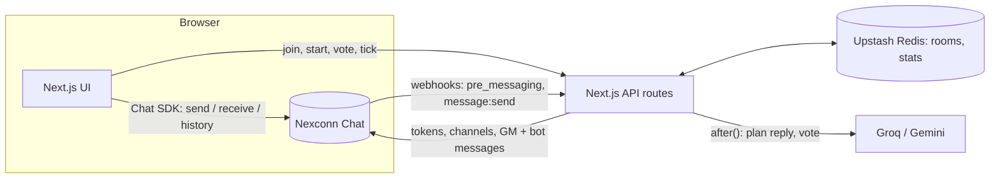

# Botched

**Party games for your group chat.** The first game, **Who's the Bot**, drops an AI into a real-time group chat disguised as one of the players. It types, hesitates, jokes and lies like a person. You have three rounds to work out which alias it is.

- 2 to 8 players, about 5 minutes, any phone or laptop
- Join with one link or QR code and a nickname. No sign-up, no install (but you can install it as an app)
- Real-time chat, typing indicators, message history and a public lounge, all on [Nexconn Chat](https://www.nexconn.ai)

| Lobby | In the game | Masks off |
| --- | --- | --- |
| Share a link or QR code; everyone joins with a nickname | Everyone has an animal alias. One of them is an AI | Real names, every vote and the bot's private thoughts |

## How a game goes

1. **Set up.** The host creates a room and shares the link. When the host starts, an AI player joins secretly with its own random alias.
2. **Chat.** The game master posts a prompt ("What's the last thing you googled? No lying."). Everyone chats for 90 seconds.
3. **Vote.** Chat locks. Everyone, the bot included, votes for who they think the bot is. Most votes is out; a tie removes nobody.
4. **Win.** Humans win the moment the bot is voted out. The bot wins if it survives every round, or if only one human is left beside it.
5. **Reveal.** Real names, every vote, a replay of the chat and the bot's inner monologue. Share the result as a card.

## Solo mode: Who's the Human

Nobody around? The game flips: **you are the only human in a chat with three AIs, and they know it.** They answer like language models, call out typos, slang and feelings, and vote out whoever seems most human. Pass as a bot for three rounds to win. The AIs play fair: they never see who the human is, only what everyone typed.

## The bot

The bot is built to blend in, not to be helpful:

- **A different character every game** (persona) with its own slang, casing, typo rate, typing speed and chattiness.
- **Human timing.** It sends a typing indicator, and how long it "types" depends on message length plus jitter. It never replies instantly.
- **Doesn't answer everything.** It decides whether to speak based on the conversation, like a real friend would.
- **Plays to survive.** It reads the room, picks a suspect and votes with a reason, which you see after the game.
- **Free-tier LLMs with fallbacks:** Groq (Llama) first, Gemini second, then hand-written lines so a game never stalls.

## Nexconn integration

| Feature | Where it's used |
| --- | --- |
| **Group channels** | Every game room is a group channel. The server creates it and adds players; browsers send and receive with `GroupChannel` and message handlers. `src/lib/nexconn-server.ts`, `src/lib/nexconn-client.ts`, `src/components/room/room-client.tsx` |
| **Open channel** | The public **Lounge** for finding players. Lobbies post invite messages that people can join with one tap. `src/components/lounge-client.tsx`, `src/app/api/lounge/route.ts` |
| **Message history** | Rejoining players load the room's history; the results screen replays the whole chat with names revealed. |
| **Custom message types** | `BT:Game` (persisted game events that tell clients to refresh) and `BT:Typing` (a status message used as a typing indicator in group chats). |
| **Server API** | Access tokens for every guest (each player is a real Nexconn user), group create/join/dismiss, and server-side sends so the game master and the AI player post as their own users. |
| **Webhooks** | `group_channel:pre_messaging` enforces the rules before delivery (only living players, only during the chat phase). `message:send` gives the server its own copy of every game message. `src/app/api/nexconn/webhook/route.ts` |
| **Connection status** | Live/reconnecting indicator in the room header. |

## Architecture



- The game itself is a pure state machine (`src/lib/game/engine.ts`) with unit tests. API routes load a room, apply one action under a lock, save it and perform the resulting effects (send messages, schedule the bot).
- The bot's thinking runs after the response is sent (`after()`), so player requests stay fast.
- The host's browser drives the round clock; every other client is a slower backup, so a game keeps going if the host drops.

## Run it locally

Requirements: Node 20+, a Nexconn app (App Key + Secret).

```bash
npm install
cp .env.example .env.local   # fill in your keys
npm run dev                  # http://localhost:3000
```

| Variable | Needed for |
| --- | --- |
| `NEXT_PUBLIC_NEXCONN_APP_KEY`, `NEXCONN_APP_SECRET` | Chat (required) |
| `NEXCONN_PRIMARY_API_DOMAIN`, `NEXCONN_SECONDARY_API_DOMAIN` | Server API for your app's data center |
| `GROQ_API_KEY`, `GEMINI_API_KEY` | The bot's replies (without them it uses fallback lines) |
| `UPSTASH_REDIS_REST_URL`, `UPSTASH_REDIS_REST_TOKEN` | Persistent rooms and stats (without them an in-memory store is used) |
| `SESSION_SECRET` | Signing guest session cookies |
| `NEXT_PUBLIC_SITE_URL` | Absolute URLs in share images |

To enable webhooks, point Nexconn's webhook URL at `https://<your-site>/api/nexconn/webhook` and subscribe to `message:send` and `group_channel:pre_messaging`.

## Tests

```bash
npm test                 # game engine, moderation and webhook signature unit tests
npm run build && ALLOW_FAST_ROOMS=1 npm start -- -p 3210
npm run e2e              # 3 browsers play a full game over Nexconn
npm run e2e:lounge       # 2 browsers meet in the lounge and join a game from an invite
npm run e2e:solo         # 1 player plays solo against three AIs
```

The end-to-end scripts use your installed Chrome through Playwright.

## Project layout

```
src/app/                 pages (landing, hub, room, lounge, leaderboard, stats, profile) and API routes
src/components/          UI, including room/ (lobby, chat, vote, results)
src/lib/game/            engine (pure state machine), runner (locking + effects), moderation
src/lib/bot/             personas, reply planning, LLM calls with fallbacks
src/lib/nexconn-*.ts     Nexconn server API client and browser SDK wrapper
tests/, scripts/         unit tests, end-to-end scripts, icon generator
```
